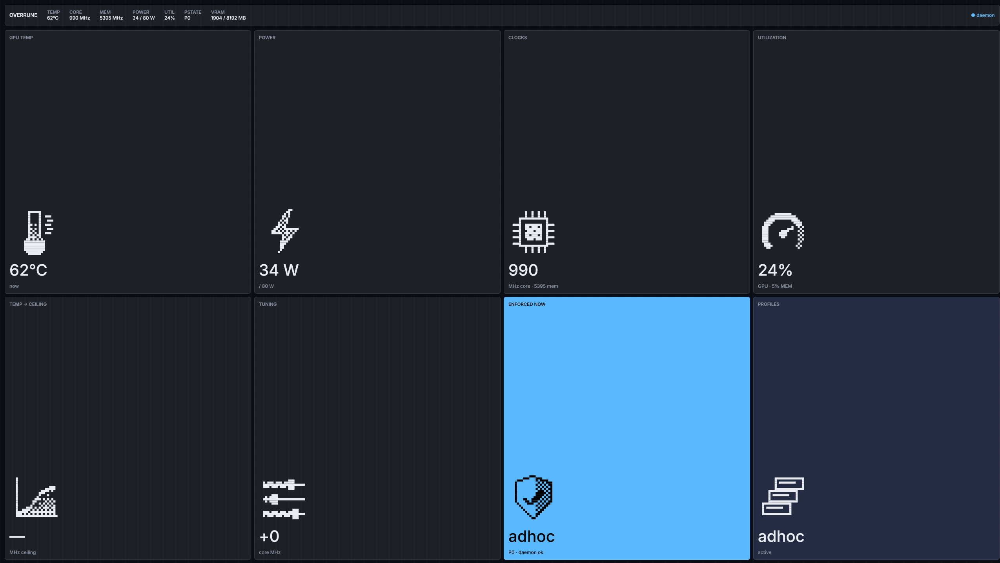

# overrune

monitor and tune an NVIDIA GPU on linux.

Everything goes through NVML, the driver's own management library, so it works
on Wayland and headless machines. It does not use `nvidia-settings` or `Coolbits`.

- **Read** clocks, temperature, power, utilization, VRAM, performance state and
  fan speed (where the GPU reports one). No privileges needed.
- **Write** core and memory clock offsets, the power limit and a locked maximum
  clock. Writes go through a small root daemon.
- **Profiles** are saved settings that the daemon re-applies after boot and
  after resume from suspend, when the driver discards them.

Not supported yet: fan control, and per-point voltage/frequency curve editing. 

## Components

| Crate | Binary | Role |
|---|---|---|
| `overrune-core` | | NVML access, profile model, IPC types |
| `overrune-cli` | `overrune` | Command-line status, watch and tuning |
| `overrune-gui` | `overrune-gui` | [Rune](https://github.com/anomalyco/rune) window with live graphs and sliders |
| `overrunerd` | `overrunerd` | Root daemon, socket-activated, authorized by polkit |

Reads happen in the client process, so `overrune` and the GUI show live data even
when the daemon is not running. Only writes need the daemon.

## Build

Requires a recent Rust toolchain (edition 2024) and the NVIDIA driver.

```sh
cargo build --release --workspace
```

## Install the daemon

```sh
sudo ./dist/install.sh
sudo systemctl daemon-reload
sudo systemctl enable --now overrunerd.socket
```

This installs `overrunerd`, `overrune` and the systemd units to `/usr/bin` and
`/etc/systemd/system`, and the polkit action to `/usr/share/polkit-1/actions`.
It does not install `overrune-gui`; run it from `target/release`.

To remove everything:

```sh
sudo ./dist/uninstall.sh
```

Saved profiles in `/etc/overrune` are left in place. Delete that directory
yourself if you want them gone.

## CLI

```sh
overrune                      # current state
overrune watch                # live view, refreshed every second
overrune --json               # one JSON object, for status bars and scripts

overrune set --core-offset 100 --mem-offset 200 --power-limit 80 --lock-clock 1800
overrune reset                # clear offsets, default power limit, unlock clocks

overrune profile list
overrune profile save quiet --power-limit 60
overrune profile use quiet
overrune profile rm quiet

overrune daemon status        # what the daemon is enforcing
```

`--device <BUS_ID>` selects a GPU by PCI bus id, for example `0000:01:00.0`.
The daemon honours `OVERRUNE_BUS_ID` for the same purpose.

Exit codes: 0 ok, 1 failure, 2 usage, 3 no NVIDIA device, 4 daemon unreachable,
5 not authorized, 6 value out of range or rejected by the driver.

## GUI



```sh
./target/release/overrune-gui
```

Tiles show live readings; click one to expand it. The sliders and Apply need the
daemon and are disabled when it is unreachable. Use a release build: the debug
build animates noticeably worse.

## How writes are authorized

The daemon listens on a Unix socket. polkit authorizes the connection once.

## Development

```sh
cargo clippy --workspace --all-targets
cargo test --workspace
```

## License

[MIT](LICENSE)
